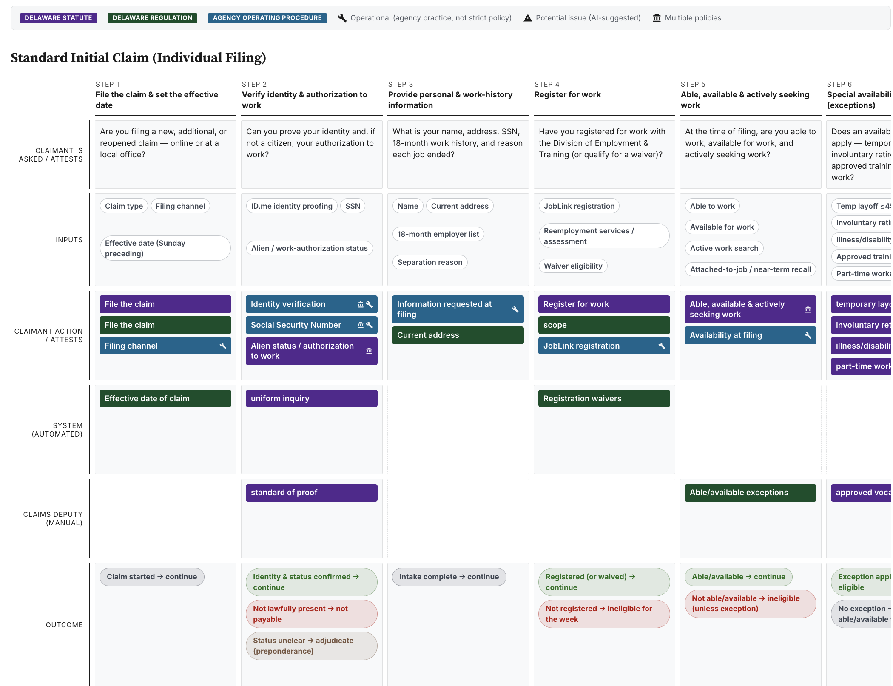

# Policy Service Blueprinter

Turns policy documents — statutes, regulations, official agency guidance — into a visual service blueprint. See a government program's rules retold through claimant actions, system actions, and caseworker/agent actions.

:robot: This skill works in Claude Cowork or Claude Code.

Requirements come from **policy only**. This skill does not map legacy system rules or requirements from other sources.

## Demo

Download and view demo service blueprints in [/demos](/demos/). Standalone `.html` files will open in your local browser.

## Install

**Claude Cowork**

1. Begin by clicking the green `<> Code` button above to download this repository as a .zip file.
2. In your downloads, open the .zip file.
3. Look for the SKILL.md file inside.
4. Load it into Cowork by clicking the file.
5. Your skill is now ready to use.

**Claude Code**

- Copy this folder into your Claude skills directory:
- Home (personal): `~/.claude/skills/policy-service-blueprinter`
- Repo (project): drop in that project's `.claude/skills/policy-service-blueprinter`
- If Claude is already running, restart it to load the skill.
- See [Use](#use) below to get started.

## Use

1. Gather links to online policy sources or prepare markdown files of all policy documents.
2. Next, in Claude Code or CoWork, paste your policy links or attach markdown files. Ask Claude "build a service blueprint."
3. Answer one scope question — the whole program, or one slice (e.g. just weekly certification, appeals, etc).
4. Then open the HTML file that Claude produces. Works on any browser, no setup.
5. Review and refine. Chat with Claude to make changes and refine your service blueprint.

### This blueprint is a draft

⚠️ AI can make mistakes. Always have a policy expert review service blueprints.
